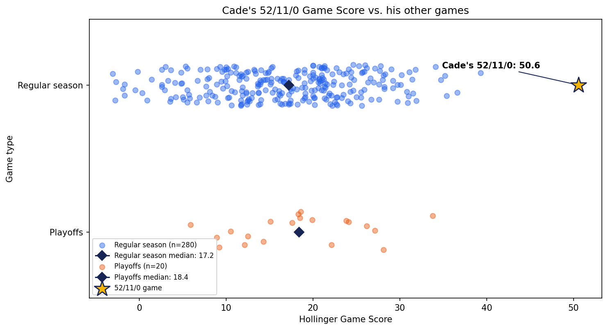
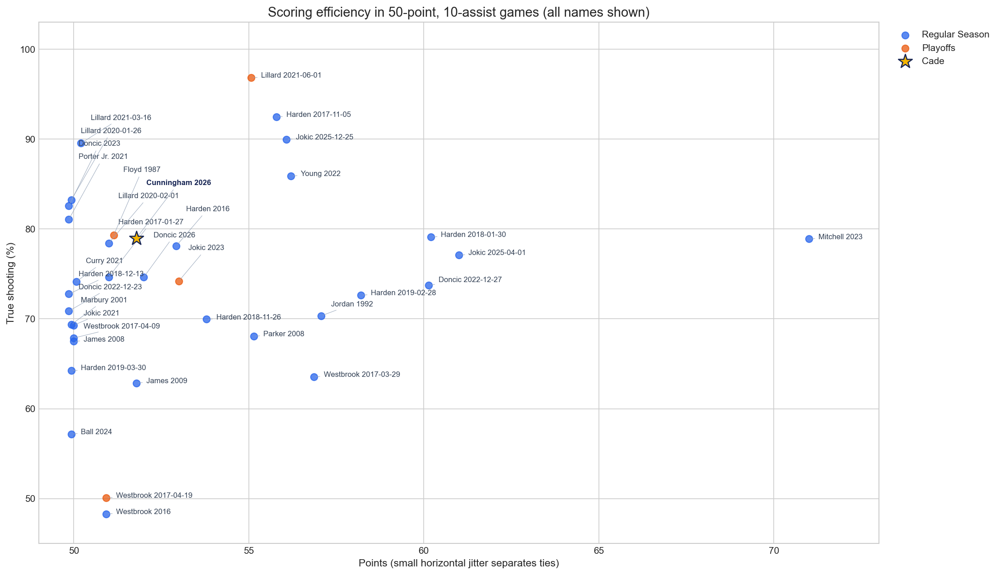
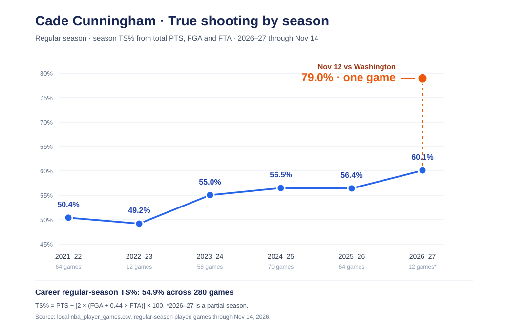
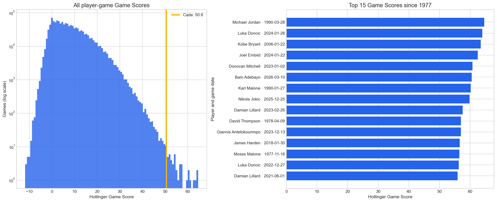
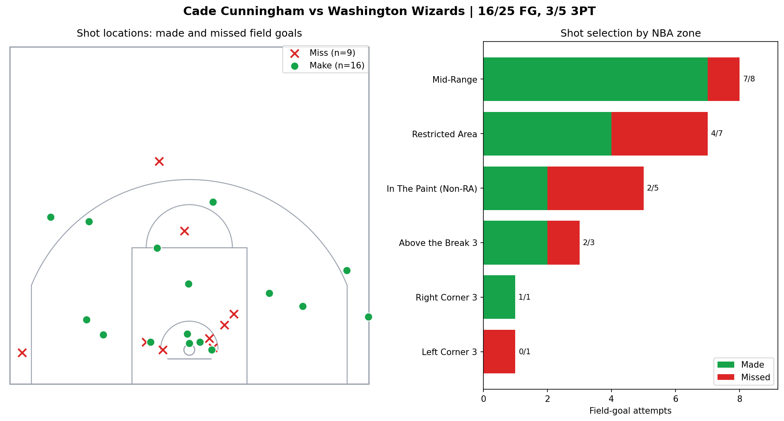

# 52 Points, 11 Assists, 0 Turnovers: How Rare Was Cade Cunningham's Night in Washington?

Cade Cunningham's career hasn't been a straight line. He missed almost all of his second season, then played through the Pistons' 28-game losing streak, and for a long stretch he was easy to overlook next to his peers around the league.

Then, on November 12, 2026, he had one of those nights people bring up for years. He scored 52 points with 11 assists and no turnovers in a 144-140 double-overtime win at Washington, a game the Wizards twice sent to extra time with last-second shots.

Nobody in my data had ever put up 50 points, 10 assists, and zero turnovers in the same game. The data starts in 1977-78, when turnovers began to be tracked, so "first" here means first since then.

That raised the question I wanted to answer: **how good was this game, compared to Cade's own career and to every other NBA night since 1977-78, and how do you put a number on it?**

## The yardstick: Game Score

I used the Hollinger Game Score, which turns a player's box score into one number. Points, rebounds, assists, steals, and blocks push it up. Missed shots, missed free throws, fouls, and turnovers pull it down. It doesn't know about pace, opponent, or defense, but it lets us compare any two box scores on the same scale. (The formula is at the bottom for anyone who wants it.)

## It's easily Cade's best game

By Game Score, Washington was a **50.6**, the highest of his 300 career games (regular season and playoffs). His next best is 39.3, from a 43-point night against Atlanta in December 2023, so the gap is 11.3 points.

**Table 1. Cade's five highest career Game Scores (regular season and playoffs).**

| Date | Opponent | PTS | AST | TOV | Minutes | Game Score |
|---|---|---:|---:|---:|---:|---:|
| 2026-11-12 | Washington Wizards | 52 | 11 | 0 | 47.98 | 50.6 |
| 2023-12-18 | Atlanta Hawks | 43 | 7 | 3 | 44.00 | 39.3 |
| 2025-02-23 | Atlanta Hawks | 38 | 12 | 3 | 37.57 | 36.6 |
| 2025-11-10 | Washington Wizards | 46 | 11 | 2 | 44.35 | 35.4 |
| 2023-12-26 | Brooklyn Nets | 41 | 5 | 3 | 36.00 | 35.2 |

*Figure 1. The gold star marks the Washington game; the other dots are his remaining regular-season and playoff games.*

So how much do the zero turnovers matter? In the formula, each turnover costs a single point, and a typical 50-and-10 game has about four of them (the average is 4.06, the median is 4). Give Cade four turnovers and his score drops to about 46.6, still far above his old best. Most of this game's value comes from 52 points on 25 shots and 17 of 18 at the free-throw line. The clean ball-handling adds a few points on top.

## Only 36 games have reached 50 and 10, and only one had no turnovers

Since 1977-78, just **36 player-games** have reached 50 points and 10 assists: 32 in the regular season and 4 in the playoffs. Cade's is the only one with zero turnovers. The next cleanest had one: Michael Jordan, Nikola Jokic, and Damian Lillard (twice).

## Efficient, but not the most efficient

Cade's true shooting percentage (TS%, a scoring-efficiency measure that counts threes and free throws) was **78.98%**, which ranks 11th among those 36 games. That's about 4.8 points above the group's median and about 17.9 points below the best, Lillard's 96.8% in the 2021 playoffs. So this wasn't the most efficient 50-and-10 game ever. The turnover column is the part that sets it apart.

**Table 2. The five highest TS% among the 36 games, plus Cade.**

| TS rank | Player | Date | PTS | AST | TS% |
|---:|---|---|---:|---:|---:|
| 1 | Damian Lillard | 2021-06-01 | 55 | 10 | 96.83 |
| 2 | James Harden | 2017-11-05 | 56 | 13 | 92.47 |
| 3 | Nikola Jokic | 2025-12-25 | 56 | 15 | 89.97 |
| 4 | Damian Lillard | 2021-03-16 | 50 | 10 | 89.54 |
| 5 | Trae Young | 2022-01-03 | 56 | 14 | 85.89 |
| 11 | Cade Cunningham | 2026-11-12 | 52 | 11 | 78.98 |

*Figure 2. Points versus TS% for the 36 games, with Cade's game highlighted.*

Against his own history, though, the night stands out. His past seasons run from 49.2% to 56.5%, and he's at 60.1% so far this season. The Washington game is about 19 points above that. One caution: big scoring nights almost always beat a player's season average, so this is context, not proof of a lasting jump.

*Figure 3. Cade's regular-season TS% by season, with the current season still in progress.*

## A top-50 game out of 1.2 million

Now the bigger comparison. Across roughly 1.2 million player-games since 1977-78, Cade's 50.6 is **tied for 43rd**, better than about 99.996% of all of them. If you watched this game, you watched a top-50 box-score night from nearly 50 seasons of NBA basketball.

The company is steep. The top five belong to some of the most famous scoring nights the league has seen.

**Table 3. The five highest Game Scores since 1977-78, plus Cade.**

| Rank | Player | Date | Opponent | Game Score |
|---:|---|---|---|---:|
| 1 | Michael Jordan | 1990-03-28 | Cleveland Cavaliers | 64.6 |
| 2 | Luka Doncic | 2024-01-26 | Atlanta Hawks | 64.0 |
| 3 | Kobe Bryant | 2006-01-22 | Toronto Raptors | 63.5 |
| 4 | Joel Embiid | 2024-01-22 | San Antonio Spurs | 62.5 |
| 5 | Donovan Mitchell | 2023-01-02 | Chicago Bulls | 60.8 |
| 43 (tied) | Cade Cunningham | 2026-11-12 | Washington Wizards | 50.6 |

*Figure 4. Every player-game since 1977-78 by Game Score, with the top performances alongside; Cade's game sits outside the top-performances panel because that panel shows only the very highest scores.*

## He scored from everywhere

The last piece is how he got there. Using shot-by-shot data, Cade made 16 of 25 field goals (64%): 6 of 12 in the paint and at the rim, 7 of 8 from mid-range, and 3 of 5 from three. Add 17 of 18 at the free-throw line, and that's the whole 52: 13 twos, 3 threes, and 17 free throws.

The point isn't that any single zone was historic. Those are small samples, and 5 threes is hardly a barrage. What stands out is that he scored from every level and lived at the line, which is the kind of balance that makes a scorer hard to guard.

**Table 4. Shot zones for the Washington game, with free throws from the box score.**

| Area | Makes | Attempts | Conversion rate |
|---|---:|---:|---:|
| Restricted area / paint | 6 | 12 | 50.0% |
| Mid-range | 7 | 8 | 87.5% |
| Three-point | 3 | 5 | 60.0% |
| All field goals | 16 | 25 | 64.0% |
| Free throws | 17 | 18 | 94.4% |

*Figure 5. Cade's made and missed field-goal attempts by zone.*

## What this can't tell us

- **The data starts in 1977-78.** "First" and "top 50" mean since then.
- **Game Score is a box-score formula.** It doesn't adjust for era, pace, opponent, or defense, and it rewards volume.
- **The game went to two overtimes.** Cade played nearly 48 minutes, and extra minutes mean extra chances to pile up stats. Five of the 36 qualifying games also have unknown overtime counts.
- **It's one game.** A single night doesn't establish a skill level or predict the next one.
- **The TS% comparison favors any big game.** The current-season number also includes this game.
- **The shot data comes from an unofficial source.** It matches the box-score points, but it can't show how defenders reacted.

## The takeaway

Cade's night in Washington was the best game of his career by Game Score, one of only 36 50-and-10 games since 1977-78, the only one of those with no turnovers, and a top-50 performance among about 1.2 million player-games. It wasn't the most efficient game of its kind. It was the cleanest and most complete one the data has seen.

## Under the hood

**Data.** Box scores come from the Kaggle dataset [*Historical NBA Data and Player Box Scores*](https://www.kaggle.com/datasets/eoinamoore/historical-nba-data-and-player-box-scores). After the build script and removing zero-minute rows, the analysis covers 1,193,262 player appearances from October 18, 1977 through November 14, 2026. Shot locations come from the unofficial `nba_api` `ShotChartDetail` endpoint, with free throws taken from the box score.

**Game Score** = PTS + 0.4·FGM − 0.7·FGA − 0.4·(FTA − FTM) + 0.7·ORB + 0.3·DRB + STL + 0.7·AST + 0.7·BLK − 0.4·PF − TOV

**True shooting %** = 100 × PTS / [2 × (FGA + 0.44 × FTA)]

Ranks count strictly higher scores, with ties sharing a rank. Season TS% uses summed points and attempts rather than averaging game percentages.

**Code and files.**
- [Analysis notebook](analysis.ipynb)
- [Dataset build script](build_cade_dataset.py)
- [Analysis script](analysis_cade.py)